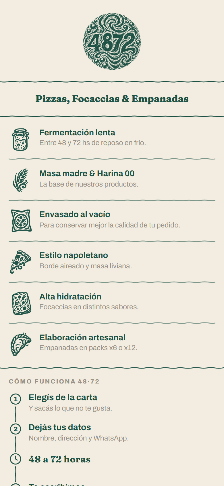
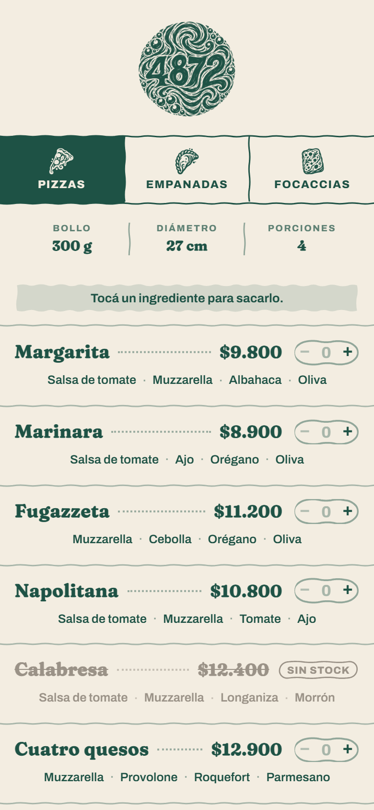
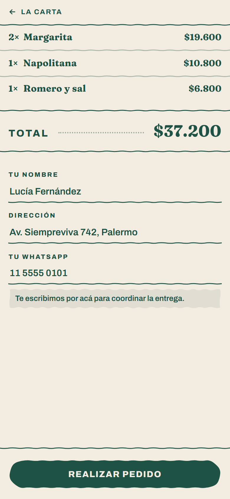
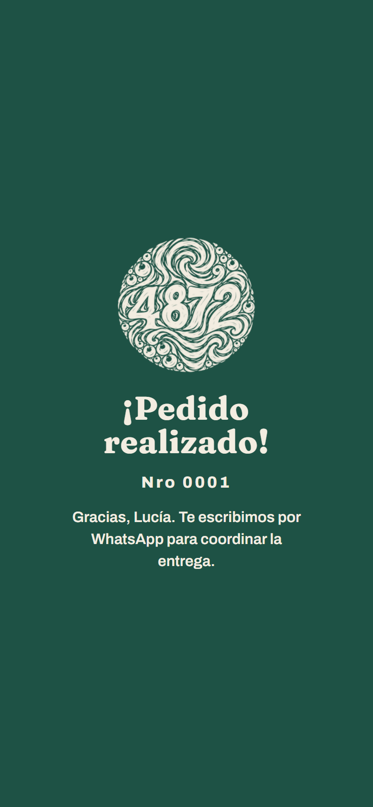
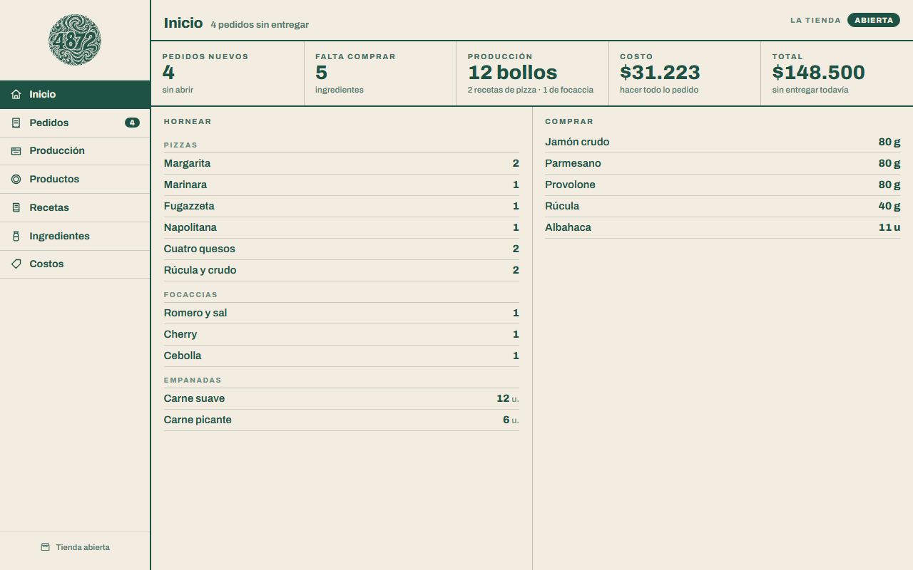
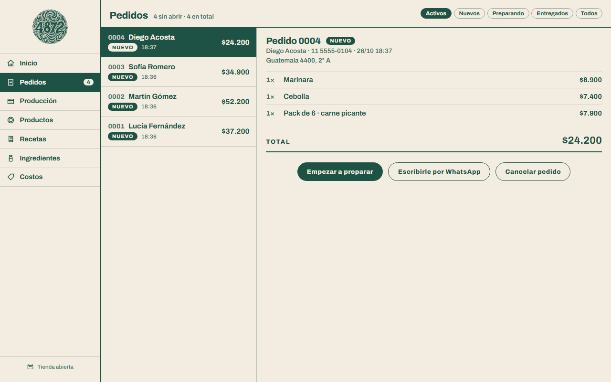
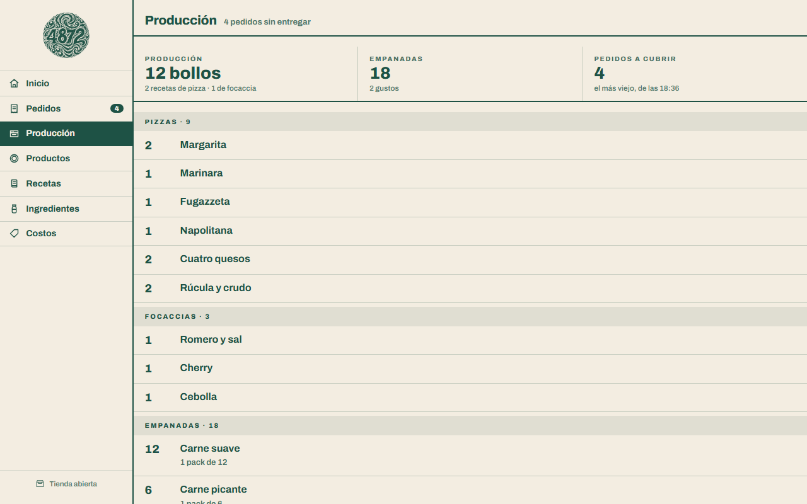
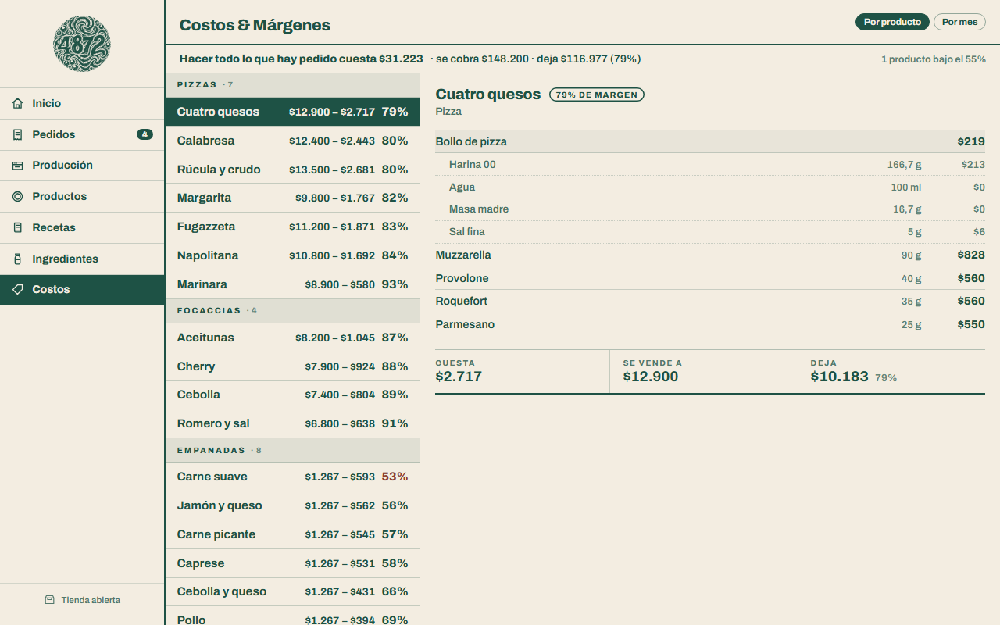

# 48·72

[](https://github.com/f-Rra/4872/actions/workflows/ci.yml)


Tienda web y panel de vendedor para una pizzería napoletana de una sola sucursal.

El cliente arma su pedido desde el teléfono, sin cuenta ni contraseña, y el vendedor recibe un aviso por Telegram y trabaja el fin de semana desde el panel: qué hornear, qué comprar y cuánto deja cada producto.

**Publicado en [4872.com.ar](https://4872.com.ar).** Las capturas son de una copia local con **datos inventados**: la carta, los precios y los pedidos no son los del negocio.

## Capturas

**La tienda**, pensada para el teléfono:

| | | | |
|---|---|---|---|
|  |  |  |  |
| Inicio | La carta, con lo agotado tachado | Tu pedido | Confirmación |

**El panel** del vendedor:

| | | | |
|---|---|---|---|
|  |  |  |  |
| Qué hornear y qué comprar | Pedidos, con WhatsApp al cliente | Producción: todo sumado para amasar una vez | Costos y márgenes por producto y por mes |

## Decisiones técnicas

- **El diseño va antes que el código.** Las pantallas se maquetaron y se midieron primero; las maquetas de [`diseño/`](diseño/) son la especificación.
- **Un modelo que respeta la cocina.** La cantidad es del par producto-ingrediente, y las recetas se cargan enteras con su rinde: el sistema divide, no la persona.
- **Sin ASP.NET Identity.** Una clave comparada en tiempo fijo, límite de 5 intentos por minuto por IP, antiforgery en el panel y las llaves de la cookie guardadas en la base.
- **Avisos por Telegram** de pedidos y de fallas (sin datos del cliente). Si Telegram falla, el pedido se guarda igual.
- **Despliegue.** `Dockerfile` en dos etapas, Railway con deploy en cada push a `main` y las migraciones al arrancar.

El porqué de cada una está en [`docs/decisiones-tecnicas.md`](docs/decisiones-tecnicas.md).

## Stack

.NET 9 · ASP.NET Core MVC · EF Core (Fluent API) · PostgreSQL · Razor y JavaScript sin librerías · CSS propio · Docker · Railway.

## Estructura

```
Controllers/   Tienda, Panel y Home (el error)
Services/      PedidoService, RecetaService, TelegramService, AvisoDeFallas
Data/          el contexto, la configuración Fluent API y el sembrador
Models/        las entidades: Producto, Ingrediente, Receta, Pedido...
Views/         Razor: Tienda/ y Panel/
wwwroot/       el CSS y el JavaScript propios
diseño/        las maquetas HTML, que son la especificación
f4872.Tests/   los tests de xUnit
```

## Tests

138 tests de xUnit sobre `PedidoService` (las reglas del checkout) y `RecetaService` (qué hornear, qué comprar y cuánto deja cada producto), con el resultado esperado calculado a mano. El [CI](.github/workflows/ci.yml) los corre en cada push. Falta probar contra un PostgreSQL real, porque la base en memoria no prueba el SQL que se genera.

## Más

[Decisiones técnicas](docs/decisiones-tecnicas.md) · [Roadmap](docs/ROADMAP.md) · [`CLAUDE.md`](CLAUDE.md)

**Facundo Herrera**
- Estudiante de la Tecnicatura Universitaria en Programación, UTN FRGP
- GitHub: [@f-Rra](https://github.com/f-Rra)
- Email: facundo.rra@gmail.com
