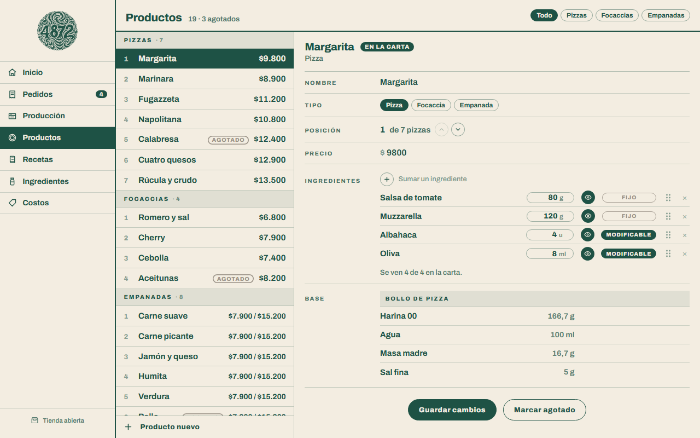

# 48·72

[](https://github.com/f-Rra/4872/actions/workflows/ci.yml)


Tienda web y panel de vendedor para una pizzería napoletana de una sola sucursal. El nombre son las horas que fermenta la masa: **se pide durante la semana y se entrega el fin de semana**.

**Publicado en [4872.com.ar](https://4872.com.ar).** Las capturas de más abajo son de una copia local con **datos inventados**: la carta, los precios y los pedidos que se ven no son los del negocio.

El cliente arma su pedido desde el teléfono, sin cuenta y sin contraseña. El vendedor recibe un aviso por Telegram y trabaja el fin de semana desde el panel: qué hornear, qué comprar, a quién escribirle por WhatsApp y cuánto deja cada producto.

## La tienda

Pensada para el teléfono, que es desde donde se pide. Cada pantalla se diseñó a 390 px de ancho.

| | | | |
|---|---|---|---|
|  |  |  |  |
| **Inicio** | **La carta**, con el stock en vivo: lo agotado sale tachado | **Tu pedido**: tres datos y listo | **Confirmación**, con el número de pedido |

- **Se pueden sacar ingredientes.** «Tocá un ingrediente para sacarlo»: una margarita sin albahaca es otro renglón del pedido, con su propio contador.
- **Las empanadas se piden por pack** de 6 o de 12, de un solo gusto.
- **El pedido vive en el navegador** hasta que se confirma: un pedido a medio armar no ocupa una fila en la base ni le avisa nada a nadie, pero sobrevive a una recarga o a un «volver atrás».
- **Lo agotado se calcula solo** a partir del stock de ingredientes. Si algo se acaba entre que se arma el pedido y se confirma, el servidor lo rechaza con un mensaje que lee una persona.

## El panel

La parte que usa el vendedor. Una clave y una cookie, sin usuarios ni roles: es una sola persona.

| | |
|---|---|
|  |  |
| **Inicio**: lo que hay que **hornear** y lo que falta **comprar**, calculado desde los pedidos sin entregar | **Pedidos**: del nuevo al entregado, con un botón para escribirle al cliente por WhatsApp |
|  |  |
| **Producción**: todo lo pedido sumado en bollos y empanadas, para amasar una sola vez | **Productos**: la carta se edita acá: ingredientes, cantidades, cuáles se pueden sacar, orden y precio |


**Costos & márgenes**: cuánto cuesta hacer cada producto, a cuánto se vende y cuánto deja, por producto y por mes. Marca en rojo lo que rinde poco.

También hay pantallas para las **recetas** (bases, salsas y rellenos) y los **ingredientes** (stock y cómo se compran).

## Cómo está hecho

**El diseño va antes que el código.** Las pantallas se maquetaron y se midieron antes de escribir la primera vista; las maquetas están en [`diseño/`](diseño/) y son la especificación. Se pueden abrir en el navegador.

**Un modelo que respeta cómo trabaja una cocina.**
- La cantidad es del *par* producto-ingrediente: una fugazzeta lleva 200 g de cebolla y una empanada de carne, 15.
- Las recetas se cargan **enteras, con su rinde**, como se amasan: 1 kg de harina da 6 bollos. El sistema divide, no la persona.
- Lo derivado no se guarda: el precio por gramo, el estado de un pedido o el margen se calculan.

**El panel no usa ASP.NET Identity**, porque no hay usuarios que gestionar. Alcanza con una clave y una cookie de un mes, con las protecciones que sí importan:
- La clave se compara en **tiempo fijo**, para que medir cuánto tarda no revele cuántas letras acertó.
- Cada intento fallido espera un segundo, y hay un **límite de 5 intentos por minuto por IP** con el limitador que trae ASP.NET Core.
- Los formularios del panel llevan token antiforgery; el del checkout, no, a propósito: ahí no hay sesión que robar.
- Las llaves que firman la cookie se guardan **en la base**, no en el disco del contenedor, así la sesión sobrevive a cada despliegue.

**Operación.**
- **Aviso de pedidos por Telegram.** Si Telegram no está configurado, el pedido se guarda igual.
- **Aviso de fallas** al mismo chat cuando algo revienta en producción: dice dónde y a qué hora, y **nunca** el texto de la excepción ni datos de un cliente. Como mucho uno cada diez minutos.
- La conexión a Telegram sale **forzada por IPv4**: en redes con IPv6 sin ruta, el cliente de .NET se quedaba esperando más de 30 segundos. Medido: con IPv4, 600 ms.
- Las fechas se guardan en UTC y se muestran en hora de Argentina, con una sola función que hace la conversión.
- La cultura `es-AR` se fija una vez al arrancar: los precios salen `$12.500` y no `$12,500.00`.

**Despliegue.** Un `Dockerfile` en dos etapas, Railway con deploy automático en cada push a `main`, PostgreSQL como servicio del mismo proyecto y Cloudflare por delante. Las migraciones corren al arrancar, así publicar es un `git push`.

## Stack

.NET 9 · ASP.NET Core MVC · EF Core code-first con Fluent API · PostgreSQL (Npgsql) · Razor y JavaScript sin librerías · CSS propio, sin frameworks · Docker · Railway.

Unas 6.400 líneas de C# (sin contar migraciones), 23 migraciones y más de 120 commits chicos: el [`ROADMAP.md`](ROADMAP.md) cuenta el plan renglón por renglón y qué cambió por el camino.

## Cómo se levanta

Hace falta el SDK de **.NET 9** y un **PostgreSQL**. Si no tenés uno instalado, se levanta en un contenedor:

```bash
docker run -d --name pg-4872 -e POSTGRES_PASSWORD=la-clave-de-la-base -p 5432:5432 postgres:17
```

```bash
git clone https://github.com/f-Rra/4872.git
cd 4872
dotnet user-secrets set "Postgres:Clave" "la-clave-de-la-base"
dotnet user-secrets set "Panel:Clave" "la-que-quieras-para-el-panel"
dotnet run
```

La tienda queda en `http://localhost:5118` y el panel en `/panel`. La base se crea sola al arrancar: no hace falta `createdb` ni `database update`.

En `Development` se siembra una carta de ejemplo con **datos inventados**, para tener algo que mirar. Lo único real que trae el código son las dos recetas de bollo, que se siembran siempre.

### En producción

Las claves no están en el repositorio. El servicio necesita cuatro variables de entorno:

| Variable | Qué es |
|---|---|
| `ConnectionStrings__Postgres` | La cadena de conexión, con la clave adentro |
| `Panel__Clave` | La clave del panel. Sin ella, el panel queda **cerrado**, no abierto |
| `Telegram__Token` y `Telegram__Chat` | El bot que avisa de los pedidos y las fallas (opcionales) |

## Tests

```bash
dotnet test
```

138 tests de xUnit sobre lo que decide plata y trabajo, que son los dos servicios con reglas de negocio:

- **`PedidoService.Confirmar`**: las reglas que apagan el botón de la tienda se repiten en el servidor, porque la pantalla se puede saltear. Datos del cliente, tienda cerrada, producto agotado, packs de empanadas, ingredientes que se pueden sacar y el aviso por Telegram, que si falla no pierde el pedido.
- **`RecetaService`**: lo que hay que hornear, lo que falta comprar y cuánto deja cada producto. Los resultados de los tests están calculados a mano sobre una cocina chica de números redondos ([`Cocina.cs`](f4872.Tests/Cocina.cs)), no copiados de lo que devolvió el código.

Para saber que los tests sirven y no solo que pasan, se rompió el servicio a propósito de unas cuarenta maneras —redondear para abajo, contar los pedidos cancelados, tomar el mes en UTC— y cada rotura tiene que hacer fallar alguno.

El [CI](.github/workflows/ci.yml) compila y corre todo en cada push y en cada pull request.

## Estructura

```
Controllers/   Tienda (la tienda), Panel (el vendedor), Home (el error)
Services/      PedidoService, RecetaService (qué hornear, qué comprar y los costos), TelegramService, AvisoDeFallas
Data/          el contexto, la configuración Fluent API de cada entidad y el sembrador
Models/        las entidades: Producto, Ingrediente, Receta, Pedido...
Views/         Razor: Tienda/ y Panel/
wwwroot/       el CSS y el JavaScript propios, y las ilustraciones
diseño/        las maquetas HTML, que son la especificación
f4872.Tests/   los tests de xUnit
```

## Qué falta

- **Tests contra PostgreSQL de verdad.** Los de hoy usan la base en memoria de EF Core: prueban las reglas, pero no que las consultas se traduzcan a SQL de Postgres ni que las restricciones de la base se cumplan. El paso que sigue es correrlos contra un Postgres real en un contenedor.
- **Tests de los controladores y de la entrada del panel** (la clave, el límite de intentos).

## Más

[`CLAUDE.md`](CLAUDE.md) tiene las convenciones de código y el modelo de datos. [`ROADMAP.md`](ROADMAP.md), el plan de trabajo y qué se hizo de verdad.
