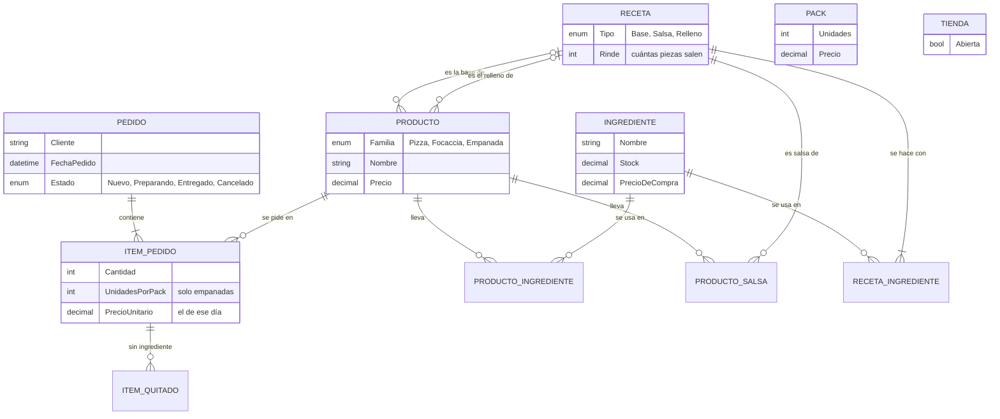
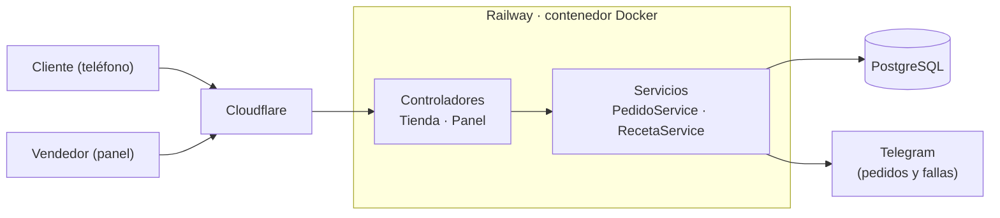

# 48·72

Tienda web y panel de vendedor para una pizzería napoletana de una sola sucursal.

**Sitio web:** [4872.com.ar](https://4872.com.ar) (la tienda). El panel es privado y se ve en las capturas, que son de una copia local con datos inventados.

## Funcionalidades

- **Pedido en un minuto desde el teléfono**, sin cuenta ni contraseña. Se pueden sacar ingredientes («una margarita sin albahaca») y las empanadas se piden por pack.
- **Carta que se actualiza sola**: lo agotado se calcula a partir del stock de ingredientes, sin que nadie lo marque.
- **Aviso de cada pedido por Telegram** al vendedor.
- **Plan de producción del fin de semana**: el panel suma todos los pedidos y calcula cuántas recetas de masa amasar y qué falta comprar.
- **Costos y márgenes** de cada producto y de cada mes, marcando lo que rinde poco.

## Capturas

**La tienda**, pensada para el teléfono:

| | | | |
|---|---|---|---|
|  |  |  |  |
| Inicio | La carta, con lo agotado tachado | Tu pedido | Confirmación |

**El panel** del vendedor:

| | | | |
|---|---|---|---|
|  |  |  |  |
| Qué hornear y qué comprar | Pedidos, con WhatsApp al cliente | Producción: todo sumado para amasar una vez | Costos y márgenes por producto y por mes |

## Stack

.NET 9 · ASP.NET Core MVC · EF Core (Fluent API) · PostgreSQL · Razor y JavaScript sin librerías · CSS propio · Docker · Railway · Cloudflare.

## Modelo de datos

La cantidad de cada ingrediente es del par producto-ingrediente, y las recetas (bases, salsas y rellenos) se cargan enteras con su rinde.

## Arquitectura

## Decisiones técnicas

- **El diseño va antes que el código.** Las pantallas se maquetaron y se midieron primero; las maquetas de [`diseño/`](diseño/) son la especificación.
- **Sin ASP.NET Identity.** Una clave comparada en tiempo fijo, límite de 5 intentos por minuto por IP, antiforgery en el panel y las llaves de la cookie guardadas en la base.
- **Recetas enteras con su rinde.** El sistema divide, no la persona: 1 kg de harina da 6 bollos.
- **Avisos por Telegram** de pedidos y de fallas, sin datos del cliente. Si Telegram falla, el pedido se guarda igual.
- **Despliegue continuo.** `Dockerfile` en dos etapas, Railway con deploy en cada push a `main` y las migraciones al arrancar.

El porqué de cada una está en [`docs/decisiones-tecnicas.md`](docs/decisiones-tecnicas.md).

## Tests y CI

138 tests de xUnit sobre `PedidoService` (las reglas del checkout) y `RecetaService` (qué hornear, qué comprar y cuánto deja cada producto), con el resultado esperado calculado a mano. El CI los corre en cada push.

## Autor

- Estudiante de la Tecnicatura Universitaria en Programación - UTN FRGP
- Email: [facundo.rra@gmail.com](mailto:facundo.rra@gmail.com)
